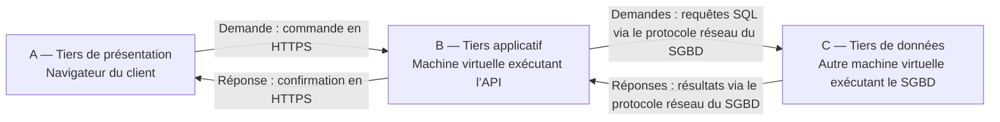

# Exercice 2 — Types d’architecture et architecture N-tiers

**Durée :** 45 minutes · **Organisation :** en binômes · **Travail :** sans coder

L’objectif est de :

- distinguer une architecture monolithique d’une architecture en microservices ;
- distinguer le modèle client-serveur du modèle pair-à-pair (Peer-to-Peer ou P2P) ;
- répartir les responsabilités entre présentation, logique métier et données ;
- distinguer les couches logiques des tiers de déploiement et expliquer une architecture à trois tiers.

## Contexte

Le Foodtruck de l’exercice 1 souhaite proposer un site permettant aux clients de consulter les pizzas et de passer commande. Le pizzaïolo doit pouvoir modifier la carte et suivre les commandes.

Vous devez analyser plusieurs organisations possibles du système, puis proposer une architecture adaptée. Aucun code n’est demandé. Vous pouvez consulter les ressources en fin d’énoncé.

Pour cet exercice :

- **monolithe / microservices** décrit le découpage et le déploiement de l’application métier ;
- **client-serveur / pair-à-pair** décrit les rôles des participants dans les échanges étudiés ;
- une **couche** regroupe des responsabilités logiques ; un **tiers** correspond à leur déploiement sur une infrastructure séparée ;
- plusieurs couches peuvent partager un même tiers ; plusieurs machines qui exécutent le même rôle peuvent appartenir au même tiers ;
- les situations de la partie 1 sont indépendantes ; les parties 2 et 3 concernent le Foodtruck.

## 1. Reconnaître les architectures — 10 minutes

### 1.1. Monolithe ou microservices ?

Pour chaque situation, identifiez l’architecture de l’application métier et justifiez votre réponse par un indice précis de l’énoncé.

| N° | Situation | Monolithe ou microservices ? | Justification |
| --- | --- | --- | --- |
| 1 | Le catalogue, les commandes et les paiements sont des modules d’une seule application. Ils sont livrés ensemble dans un même programme serveur. | Monolithe | Tous les services de l'application sont dans le meme "pacjage" |
| 2 | Le catalogue, les commandes et les paiements sont des services autonomes. Chaque service est déployable séparément, communique par une API et gère ses propres données. | Microservice | chaque service fonctionne indépendemment des autres |
| 3 | Pour accueillir davantage de clients, on lance quatre copies identiques du programme de la situation 1 derrière un répartiteur de charge. Chaque copie contient tous les modules. | Monolithe | Les différents services sont dépendant des autres, on ne peut pas en arreter un et les autres continuent de fonctionner |

### 1.2. Client-serveur ou pair-à-pair ?

Identifiez le modèle des échanges décrits. Précisez qui demande et qui fournit les données. Si plusieurs modèles coexistent, indiquez lesquels et pour quels échanges.

| N° | Situation | Modèle des échanges | Rôles des participants |
| --- | --- | --- | --- |
| 4 | Les tablettes des clients demandent la carte au serveur du Foodtruck. Elles ne fournissent aucune donnée aux autres tablettes. | 	Client-serveur | Les tablettes sont les clients : elles demandent la carte. Le serveur du Foodtruck répond aux demandes |
| 5 | Des ordinateurs s’échangent directement des morceaux d’un fichier. Chacun peut télécharger des morceaux et transmettre ceux qu’il possède déjà. | Peer - Peer | Chaque ordinateur est un pair : il joue à la fois le rôle de client pour télécharger et de serveur pour transmettre des morceaux. |
| 6 | Un serveur central fournit une liste d’ordinateurs possédant un fichier. Les ordinateurs utilisent ensuite cette liste pour échanger directement les morceaux entre eux. | Hybride : client-serveur et P2P | Client-serveur : les ordinateurs demandent la liste des détenteurs du fichier au serveur central, qui la fournit. Pair à pair : les ordinateurs demandent et fournissent ensuite directement les morceaux du fichier entre eux. |

## 2. Concevoir une architecture à trois tiers — 15 minutes

Le Foodtruck retient le déploiement suivant :

- **A :** le navigateur du client, qui affiche l’interface et exécute le code de présentation ;
- **B :** une machine virtuelle qui exécute une API regroupant tout le traitement métier dans une seule application déployable ;
- **C :** une autre machine virtuelle qui exécute le système de gestion de base de données.

Le navigateur communique uniquement avec l’API, en HTTPS. L’API envoie des requêtes SQL à la base par le protocole réseau du système de gestion de base de données choisi. Le navigateur n’accède jamais directement à la base de données. On ne représente pas le téléchargement initial des fichiers de l’interface.

### 2.1. Répartir les responsabilités

#### a. Associer les couches à leur emplacement

Associez chaque couche à son emplacement (**A**, **B** ou **C**) dans le déploiement décrit ci-dessus.

| Couche | Emplacement |
| --- | --- |
| Présentation | A |
| Logique métier | B |
| Données | C |

#### b. Associer les responsabilités aux couches

Pour chaque responsabilité, indiquez uniquement la couche concernée : **présentation**, **logique métier** ou **données**.

La vérification du prix relève des règles métier, même si la présentation propose aussi une validation de formulaire.

| N° | Responsabilité | Couche |
| --- | --- | --- |
| 1 | Afficher la carte des pizzas et le formulaire de commande. | présentation |
| 2 | Afficher le message de confirmation reçu après une commande. | présentation |
| 3 | Vérifier qu’un prix de pizza n’est pas négatif selon les règles métier. | logique métier |
| 4 | Calculer le total d’une commande à partir des prix de référence. | logique métier |
| 5 | Vérifier que l’utilisateur a le droit de modifier la carte. | logique métier |
| 6 | Stocker durablement les pizzas et les commandes. | données |
| 7 | Exécuter une requête SQL pour retrouver une commande. | données |

#### c. Ajouter une couche au système

La couche métier contient actuellement les règles de commande et le code qui prépare les requêtes SQL. Vous souhaitez isoler ce code pour pouvoir changer de système de base de données en limitant les modifications des règles métier.

1. Proposez un nom pour cette nouvelle couche.
2. Donnez deux responsabilités de cette couche et une responsabilité qui doit rester dans la couche métier.
3. Dessinez un schéma des **quatre couches**, avec des flèches indiquant le sens des appels.

**Réponse :**

1. **Nom:** couche d’accès aux données (DAL ou DAO).

2. **Deux responsabilités de cette couche :**
   - Préparer et envoyer les requêtes SQL au système de gestion de base de données.
   - Transformer les résultats reçus en objets utilisables par la couche métier.

3.  **Responsabilité qui reste dans la couche métier :**
   - calculer le total d’une commande à partir des prix de référence.

4. **Schéma des quatre couches :**

```text
Présentation (A)
       ↓
Logique métier (B)
       ↓
Accès aux données (B)
       ↓
Données (C)
```

Cette variante concerne uniquement la question c. La suite reprend l’architecture initiale à trois couches.

### 2.2. Représenter les échanges

Dessinez le schéma des trois tiers en Mermaid ou dans un bloc de texte Markdown. Indiquez :

1. le nom de chaque tiers et son emplacement ;
2. les liens autorisés, avec les protocoles ;
3. les flèches des demandes et des réponses.

Décrivez ensuite en **quatre à six étapes** le parcours d’une commande, depuis le clic sur « Commander » jusqu’à l’affichage de la confirmation. Le serveur doit valider la commande et calculer son total avant de l’enregistrer.

**Schéma et étapes :**



1. Le client clique sur **« Commander »**. Le navigateur envoie les informations de la commande à l’API en **HTTPS**.
2. L’API demande à la base les données nécessaires, notamment les prix de référence, par des requêtes SQL. Le SGBD lui renvoie les résultats.
3. L’API **valide la commande** selon les règles métier et **calcule son total** à partir des prix de référence.
4. Si la commande est valide, l’API envoie une requête SQL pour l’enregistrer dans la base de données.
5. Le SGBD confirme l’enregistrement. L’API renvoie alors une confirmation avec le total au navigateur en **HTTPS**.
6. Le navigateur affiche la confirmation de la commande au client.

### 2.3. Distinguer couches et tiers

On considère une application qui conserve les mêmes trois couches logiques : présentation, logique métier et données. Pour chaque déploiement ci-dessous, indiquez le nombre de tiers selon les conventions de l’exercice.

| Déploiement | Nombre de tiers | Justification |
| --- | --- | --- |
| Application locale avec une base embarquée sur le même poste. | 1 | Les trois couches s’exécutent sur un seul poste. |
| Application de bureau avec présentation et logique métier sur le poste utilisateur, et base sur un serveur distant. | 2 | La présentation et la logique métier forment un tiers sur le poste utilisateur. La base de données constitue un deuxième tiers sur le serveur distant. |
| Navigateur, API métier sur une machine virtuelle et base sur une autre machine virtuelle. | 3 | La présentation, la logique métier et les données sont réparties sur trois tiers distincts : le navigateur, le serveur applicatif et le serveur de données. |

## 3. Justifier un choix d’architecture — 10 minutes

Répondez en deux ou trois phrases par question en vous appuyant sur les contraintes données.

### 3.1. Démarrer avec une petite équipe

Deux développeurs réalisent le site du Foodtruck. Le trafic est faible, les fonctionnalités sont simples et les mises à jour peuvent être livrées ensemble. L’équipe dispose de peu de temps pour gérer l’infrastructure.

Choisiriez-vous un monolithe ou des microservices pour l’API métier ? Donnez un avantage et une limite de votre choix.
**Réponse :**

> Je choisirais un monolithe pour l’API métier, car les fonctionnalités sont simples et les mises à jour peuvent être livrées ensemble. Son avantage est de simplifier le déploiement et la gestion de l’infrastructure pour les deux développeurs. Sa limite est qu’une modification d’une fonctionnalité nécessite de redéployer l’ensemble de l’API.

### 3.2. Faire évoluer la plateforme

Le Foodtruck devient une plateforme pour 200 restaurants. Trois équipes gèrent respectivement le catalogue, les commandes et les paiements. Elles doivent publier leurs évolutions séparément. Les paiements nécessitent davantage de capacité à certaines heures. L’organisation dispose désormais d’une équipe d’exploitation.

Quel découpage proposeriez-vous ? Donnez un bénéfice lié aux contraintes et une difficulté supplémentaire à gérer.

**Réponse :**

> Je proposerais trois microservices : catalogue, commandes et paiements, chacun géré par l’équipe correspondante. Ce découpage permet aux équipes de publier indépendamment leurs évolutions et d’augmenter uniquement la capacité du service de paiement aux heures chargées. Il faut cependant gérer davantage de communications réseau, leurs pannes possibles et la cohérence des données entre les services.

### 3.3. Combiner les notions

Dans le déploiement de la partie 2, l’API métier est-elle monolithique ou composée de microservices ? Quel est le modèle des échanges entre le navigateur et l’API ? Combien de tiers sont représentés ? Expliquez pourquoi ces réponses sont compatibles.

**Réponse :**

> L’API métier est monolithique, car tous les traitements métier sont regroupés dans une seule application déployable. Le navigateur et l’API échangent selon le modèle client-serveur, et le déploiement comporte trois tiers : présentation, applicatif et données. Ces réponses sont compatibles, car elles décrivent respectivement le découpage de l’API, les rôles dans les échanges et la répartition du déploiement.

## 4. Vrai ou faux : vérifier une architecture — 10 minutes

Indiquez **Vrai** ou **Faux**. Corrigez chaque proposition fausse.

| N° | Proposition | Vrai ou faux ? | Correction si faux |
| --- | --- | --- | --- |
| 1 | Une application qui possède trois couches logiques est forcément déployée sur trois tiers. | Faux | Les couches organisent les responsabilités du code. Plusieurs couches peuvent s’exécuter dans un même tiers. |
| 2 | Une API métier monolithique peut participer à une architecture à trois tiers. | Vrai | — |
| 3 | Exécuter plusieurs copies identiques d’un monolithe transforme automatiquement l’application en microservices. | Faux | Cela crée plusieurs instances du même monolithe. Les microservices nécessitent un découpage en services autonomes déployables indépendamment. |
| 4 | Dans un échange pair-à-pair, un même participant peut demander des données et en fournir. | Vrai | — |
| 5 | Si un serveur aide les participants à se découvrir, les transferts de fichiers entre eux ne peuvent pas être pair-à-pair. | Faux | La découverte peut utiliser le modèle client-serveur, tandis que les transferts directs entre participants utilisent le modèle pair-à-pair. |
| 6 | Dans l’architecture du Foodtruck de la partie 2, le navigateur peut contourner l’API et modifier directement la base. | Faux | Le navigateur communique uniquement avec l’API en HTTPS. Seule l’API accède à la base de données. |
| 7 | Les microservices suppriment les problèmes de panne réseau entre les composants. | Faux | Les échanges entre microservices dépendent du réseau : il faut gérer les pannes, les délais et les interruptions de communication. |
| 8 | Une architecture N-tiers comporte obligatoirement exactement trois tiers. | Faux | Le nombre de tiers est variable. Une architecture à trois tiers est un cas particulier d’architecture N-tiers. |

      
9:34

## Livrable

Placez le fichier `exercice-2.md` dans un dossier `exercice/` à la racine de votre dépôt.

## Ressources

- [AWS — Monolithe et microservices](https://aws.amazon.com/compare/the-difference-between-monolithic-and-microservices-architecture/)
- [Microsoft Learn — Architecture en microservices](https://learn.microsoft.com/en-us/azure/architecture/guide/architecture-styles/microservices)
- [MDN — La relation client-serveur](https://developer.mozilla.org/fr/docs/Learn_web_development/Extensions/Server-side/First_steps/Client-Server_overview)
- [RFC 5694 — Architectures pair-à-pair, sections 2 et 3 (anglais)](https://www.rfc-editor.org/rfc/rfc5694)
- [IBM — Architecture à trois tiers (anglais)](https://www.ibm.com/think/topics/three-tier-architecture)
- [Microsoft Learn — Architecture N-tiers (anglais)](https://learn.microsoft.com/en-us/azure/architecture/guide/architecture-styles/n-tier)
